# Milling Condition Safety Monitor

## Detecting Non-Optimal Cutting Parameters from Vibration and Current Signals

**ME-446 Artificial Intelligence & Internet of Things — Complex Engineering Problem, Fall 2026**
Department of Mechanical Engineering, NED University of Engineering and Technology, Karachi

| | |
|---|---|
| **Group** | ____________________ |
| **Group members** | ____________________ |
| **Submitted to** | Course teacher, ME-446 |
| **Submission date** | 04 November 2026 |
| **Dataset** | Piecuch & Żabiński, *Scientific Data* 12, 650 (2025), CC BY 4.0 |
| **Code and artifacts** | This repository (`milling-cep/`) |

---

## Executive summary

This project builds an AI safety monitor for CNC milling. The public dataset used by Piecuch and
Żabiński contains 968 milling cycles recorded with eight accelerometer channels and twelve current
channels, under two radial depth-of-cut (RDOC) settings: an optimal 4.5 mm and an aggressive 8 mm.
Instead of reproducing the authors' tool-wear model, this CEP treats RDOC as a categorical target and
asks a new engineering question: **can a model detect a non-optimal, high-risk cut from the sensor
signature alone, before the condition damages the tool or the machine?**

A random forest was selected from four candidates after grouped validation. At a tuned threshold of
0.444 it flags **96.2 %** of dangerous cycles (204 of 212) with **69.9 %** precision and an MCC of
**0.762**. Leave-one-tool-out validation gives the same recall (0.962) and MCC 0.778, and a model
trained without experiments P002 and P108 flags 97.8 % of the unseen dangerous experiment while
clearing 100 % of the unseen optimal experiment. The main residual risk is a high false-alarm rate on
one optimal tool (tool 7), which is traced to the dataset's confounded design: RDOC is constant within
each tool and experiment, so tool identity, material batch and wear stage cannot be fully separated
from the cutting condition.

The work delivers cleaned and audited data, a reproducible notebook, eleven publication-quality
figures, a Streamlit dashboard, Tableau-ready extracts with a build guide, and this report.

---

## 1. Engineering problem formulation

### 1.1 Context

In CNC milling, the radial depth of cut controls how much of the cutter's diameter engages the
workpiece. A conservative engagement (RDOC = 4.5 mm on a 10 mm cutter) is stable and is used for
normal production. A very large engagement (RDOC = 8 mm, i.e. 80 % of the diameter) raises the chip
load, the cutting force and the spindle torque. If the setup, holder or fixture is not stiff enough,
the result is chatter, overload, accelerated tool wear, scrap or a broken tool. The operator normally
knows the programmed parameters, but a process monitor does not: it sees only vibration and current.
The engineering value of the model is as an independent check that the machine is running the
condition it is supposed to run, and as an alarm when an aggressive parameter set is used
unintentionally or without the matching tool.

### 1.2 Objective and task type

**Objective:** classify each milling cycle as *optimal* (RDOC = 4.5 mm) or *non-optimal / dangerous*
(RDOC = 8 mm) from the accelerometer and current statistics of that cycle.

| Item | Definition |
|---|---|
| Task | Supervised binary **classification** (not regression, not wear estimation) |
| Target | `RDOC_class = 1` if RDOC = 8 mm, `0` if RDOC = 4.5 mm |
| Inputs | 120 sensor statistics: 8 accelerometer channels and 12 current channels, each with min, max, mean, std, skew and kurtosis |
| Unit of analysis | One milling cycle (`Pxxx_Fyy_Czz`) |
| Grouping unit | Cutting tool (`ToolIndex`) — the leakage-safe validation unit |
| Positive class | Dangerous (minority: 212 of 968 cycles, 21.9 %) |
| Operational decision | Flag the cycle for operator attention; not an automatic machine stop |

The task is a **process-monitoring** problem, not a tool-life problem. It is deliberately different
from the source paper's wear regression and uses a target that the original authors did not model,
which satisfies the CEP requirement for a novel analysis on an open dataset.

### 1.3 Significance of the variables

A larger radial engagement increases the engaged cutting-edge length and the chip cross-section.
Cutting force and spindle torque rise roughly proportionally, which appears as a higher mean
spindle/drive current, greater current fluctuation and higher vibration amplitude. The mean of the
drive-axis acceleration is sensitive to the static force offset; the standard deviation of the drive
and spindle currents is sensitive to load fluctuation; kurtosis and skew capture impulsive or
chattering behaviour. These statistics are therefore not arbitrary features: they are the signatures
that cutting mechanics predicts should change with RDOC.

---

## 2. Dataset

### 2.1 Source and licence

Piecuch, M. & Żabiński, T., *A new open dataset from a milling process – data for classification and
estimation of tool life*, **Scientific Data 12, 650 (2025)**.
DOI: [10.1038/s41597-025-04923-y](https://doi.org/10.1038/s41597-025-04923-y)

Data archive: DOI [10.6084/m9.figshare.28589216](https://doi.org/10.6084/m9.figshare.28589216),
licensed **CC BY 4.0**. Accessed October 2026. The raw files are kept unchanged in `data/raw/`
(`FeatureAndMetadata_Milling.csv`, `metadata.xlsx`); the raw 25 GB time-series archive is not
redistributed and was not available locally.

### 2.2 Structure

| Property | Value |
|---|---:|
| Milling cycles (rows) | 968 |
| Experiments (workpieces) | 24 |
| Layers | 172 |
| Cutting tools | 14 |
| Sensor statistics | 120 |
| Source metadata columns | 11 |
| Accelerometer channels | 8 |
| Current channels | 12 |
| Constant process settings | 3200 rpm, 640 mm/min, 10 mm cutter |
| Dangerous cycles | 212 (21.9 %) |
| Optimal cycles | 756 (78.1 %) |
| Experiments / tools with both classes | 0 / 0 |

Two independent sources (the feature CSV and `metadata.xlsx`) were cross-checked row for row. All
nine shared metadata fields, the row order and the row count (968) match exactly, so the merge cannot
silently misalign a cycle with its metadata.

---

## 3. Data audit and preprocessing

### 3.1 Audit findings

| Check | Result | Decision |
|---|---|---|
| Missing values | 0 | None needed |
| Duplicate full rows | 0 | None |
| Duplicate sensor vectors | 0 | None |
| Infinite sensor values | 0 | None |
| Zero-variance sensor features | 0 | None |
| Constant predictors | `ToolRotation`, `FeedRate`, `ToolDiameter` | Excluded — no information |
| Censored cycles (`CycleToFailure = 0`) | 14 | Retained — valid failure records |
| Single-cycle experiment | P114 | Retained — genuine early failure |
| Accelerometer values at the ADC floor | 4 rows | Retained — genuine clipping |
| Rows with ≥ 5 features outside a 5×IQR fence | 52 | Flagged, **not deleted** |
| Experiments / tools containing both classes | 0 / 0 | Grouped validation required |
| Tool type 2 at RDOC = 8 mm | 0 cycles | Discussed as a confound |

The raw CSV has a UTF-8 BOM, a semicolon delimiter, a redundant first header row and mixed decimal
conventions (comma decimals in metadata, dot decimals in sensor columns). These were parsed
explicitly; the real header is on row 2. No row was deleted. Deleting the censored records, the
single-cycle failure or the statistical outliers would remove exactly the difficult cases a safety
monitor must handle, and the source paper treats them as valid observations.

### 3.2 Target and feature preparation

- **Target:** `RDOC_class = 1` for RDOC = 8 mm, `0` for 4.5 mm.
- **Features:** the 120 sensor statistics only. Identifiers, process settings, hardness, tool
  metadata and remaining-life counters are excluded, so the model cannot read the answer or a
  wear proxy directly.
- **Transform:** `signed_log1p(x) = sign(x)·ln(1+|x|)` compresses the very large raw ADC counts while
  preserving sign. It is applied to every feature for every model.
- **Scaling:** robust scaling (median/IQR) is added for logistic regression only; tree models do not
  need it.
- **Imbalance:** balanced class weights (logistic regression, random forest) and threshold selection.
  No SMOTE or random oversampling, because synthetic sensor vectors would no longer correspond to
  physically achievable cutting states.
- **Feature selection:** none. The models regularise or split on 120 correlated features directly;
  removing features on the full data before cross-validation would leak information.

### 3.3 Validation design

RDOC and ADOC are **constant within every experiment and every tool**. A random row split therefore
places cycles from the same tool in both training and test, and a flexible model can memorise that
tool's signature. This is leakage through grouping, not through a feature column.

Four schemes are used:

1. **5-fold tool-group cross-validation (primary).** Whole tools are held out; each fold contains at
   least one dangerous and one optimal tool. Hyperparameters are tuned inside each outer fold on the
   training tools only (nested grouped CV), so the outer estimate never sees the held-out tool during
   tuning.
2. **Leave-one-tool-out (stress test).** Fourteen folds, one tool each. This is the closest available
   proxy for deploying on a tool the model has never seen.
3. **Leave-one-experiment-out (sensitivity).** Twenty-four folds; tests generalisation to a new
   workpiece/layer structure.
4. **Random 5-fold (leakage control only).** Reported to quantify how optimistic a naive split is; it
   is never used to select the model or quote performance.

A chronological split is not appropriate here: the rows are individual cycles grouped by tool and
experiment, not a continuous time series of one process, and the source file is ordered by
experiment. A chronological cut would put whole tools and conditions on one side and reproduce the
same confounding in a less controlled way. Grouping by tool is the technically justified split.

### 3.4 Leakage control: what the random split would have claimed

| Model | ROC-AUC | PR-AUC | Recall | MCC |
|---|---:|---:|---:|---:|
| Random forest, random 5-fold | 0.998 | 0.994 | 0.976 | 0.933 |
| Random forest, tool-grouped 5-fold | 0.942 | 0.688 | 0.892 | 0.742 |
| Hist gradient boosting, random 5-fold | 1.000 | 0.999 | 0.986 | 0.988 |
| Hist gradient boosting, tool-grouped 5-fold | 0.936 | 0.782 | 0.877 | 0.650 |

The random split inflates ROC-AUC by about 0.06 and PR-AUC by about 0.21–0.31. Presenting the
random-split number would have been a serious methodological error, so the grouped results are used
throughout this report.

---

## 4. Exploratory analysis and engineering insights

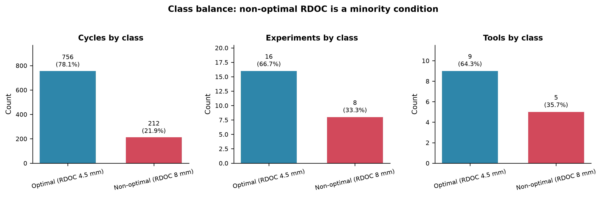

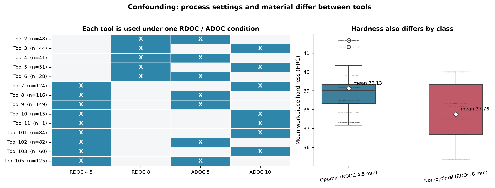

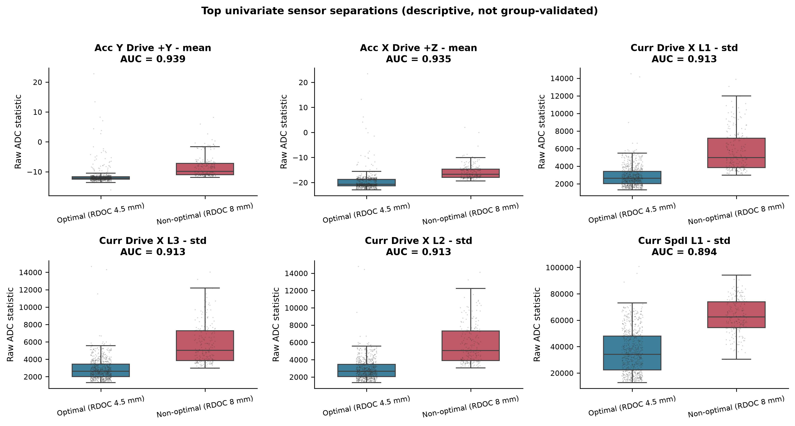

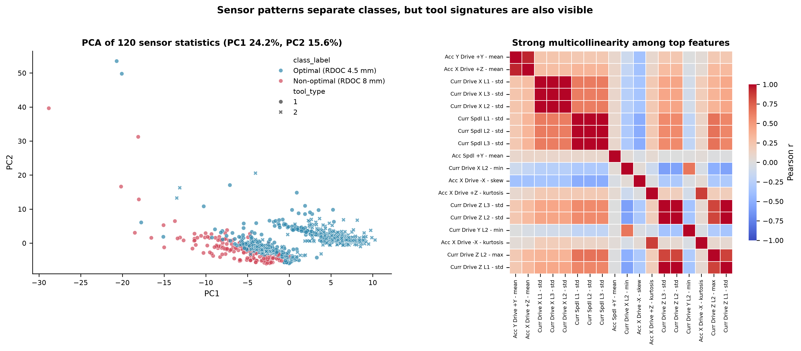

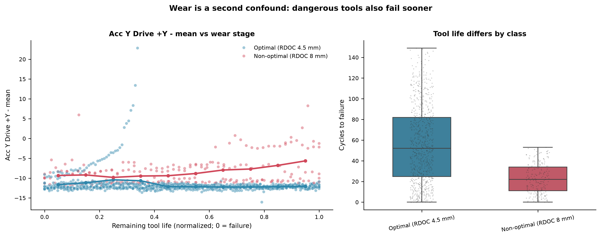

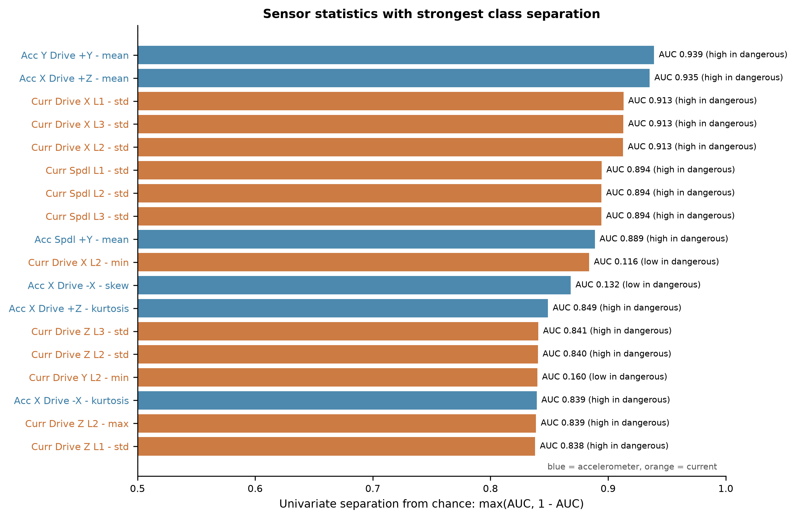

### Insight 1 — the dangerous condition is a minority, so accuracy is misleading

Only 212 of 968 cycles (21.9 %), 8 of 24 experiments and 5 of 14 tools operate at RDOC = 8 mm. A
classifier that always predicts "optimal" already scores 78.1 % accuracy while catching zero dangerous
cycles. The report therefore leads with recall on the dangerous class, PR-AUC, MCC and the confusion
matrix, and treats accuracy as a secondary descriptive number.

### Insight 2 — RDOC is perfectly confounded with tool and experiment identity

Every tool and every experiment uses exactly one RDOC/ADOC combination. Tool type 2 is never used at
RDOC = 8 mm, so the dangerous class is also entirely tool type 1. The dangerous group has a lower mean
hardness (about 38 HRC versus 39 HRC) and a different remaining-life distribution. A model can
therefore separate the classes by recognising the tool or the material rather than the cut. Grouped
validation limits the optimism, but the confound cannot be removed by modelling; it is a property of
the experimental design.

### Insight 3 — the sensor signal is strong and physically plausible

The strongest univariate features are the mean acceleration on the drive axes (AUC 0.935–0.939) and
the standard deviation of the drive/spindle currents (AUC 0.894–0.913). All are higher in the
dangerous class. That is the direction cutting mechanics predicts for a larger radial engagement, so
the separation is not an artefact of a few extreme rows.

| Feature | Univariate ROC-AUC | Direction |
|---|---:|---|
| Accelerometer – Y driving axle +Y – mean | 0.939 | higher in dangerous |
| Accelerometer – X driving axle +Z – mean | 0.935 | higher in dangerous |
| Current – driving axle X L1 – std | 0.913 | higher in dangerous |
| Current – driving axle X L3 – std | 0.913 | higher in dangerous |
| Current – driving axle X L2 – std | 0.913 | higher in dangerous |
| Current – spindle L1 – std | 0.894 | higher in dangerous |
| Current – spindle L2 – std | 0.894 | higher in dangerous |
| Current – spindle L3 – std | 0.894 | higher in dangerous |

### Insight 4 — wear is a competing explanation

Dangerous tools fail sooner: mean cycles to failure 22.7 versus 55.8 for optimal tools. Sensor
features also drift as a tool wears, so part of the class separation may reflect wear stage rather
than RDOC. The probability-versus-remaining-life view in the dashboard makes this visible; it is
treated as a limitation, not hidden. The false alarms on tool 7 cluster late in tool life (mean
normalised life 0.33), which is consistent with wear pushing an optimal tool into a
dangerous-looking signature.

### Insight 5 — material and tool type differ by class

Tool type 2 never appears at RDOC = 8 mm, and the dangerous group has lower hardness. These
differences are plausible false-positive drivers: an optimal cut with a harder workpiece can produce
higher forces and currents, and the model has no hardness input to distinguish the two causes. This
is another reason to present the model as a screening alarm rather than a definitive diagnosis.

---

## 5. Models and validation

### 5.1 Candidate models and justification

| Model | Why it is appropriate | Configuration |
|---|---|---|
| Dummy (prior) | Establishes the no-skill baseline for this class balance | Predicts the majority class |
| Logistic regression | Transparent linear reference; tests whether a simple decision boundary is enough with 120 correlated, heavy-tailed features | Balanced class weights, robust scaling, `C` tuned |
| Random forest | Captures thresholds and interactions across correlated vibration/current channels without hand-crafted features; robust to outliers and to the large ADC scale after the log transform | 150 trees, balanced subsample weights, depth and leaf size tuned |
| Histogram gradient boosting | Strong modern tabular learner; tests whether boosting beats bagging on this dataset | Learning rate, leaf nodes and L2 tuned |

All four were evaluated on exactly the same folds and the same feature matrix.

### 5.2 Primary comparison (5-fold tool-group CV, threshold 0.5)

| Model | ROC-AUC | PR-AUC | Recall | Precision | F1 | Specificity | MCC | Brier | Accuracy |
|---|---:|---:|---:|---:|---:|---:|---:|---:|---:|
| Dummy (prior) | 0.386 | 0.184 | 0.000 | 0.000 | 0.000 | 1.000 | 0.000 | 0.173 | 0.781 |
| Logistic regression | 0.940 | 0.733 | 0.948 | 0.663 | 0.781 | 0.865 | 0.725 | 0.093 | 0.883 |
| **Random forest** | **0.942** | 0.688 | 0.892 | **0.724** | **0.799** | **0.905** | **0.742** | **0.082** | **0.902** |
| Hist gradient boosting | 0.936 | **0.782** | 0.877 | 0.620 | 0.727 | 0.849 | 0.650 | 0.107 | 0.855 |

At the fixed 0.5 threshold the random forest has the best precision, F1, specificity, MCC, Brier and
accuracy; logistic regression has slightly higher recall and a very similar ROC-AUC; gradient boosting
has the best threshold-independent PR-AUC but the weakest operating point. Because a safety monitor
can move its threshold, the selection was confirmed at the tuned operating point rather than at 0.5.

### 5.3 Threshold selection

The threshold was chosen on the pooled out-of-fold probabilities of the random forest by maximising
F1. This gives **0.4437**, below 0.5 because the class is imbalanced and because a missed dangerous
cut is more expensive than a false alarm.

| Operating point | Threshold | Recall | Precision | F1 |
|---|---:|---:|---:|---:|
| Max-F1 (selected) | 0.444 | 0.962 | 0.699 | 0.810 |
| Highest precision with recall ≥ 0.90 | 0.499 | 0.901 | 0.726 | 0.803 |

Raising the threshold to 0.499 buys 2.7 points of precision but costs 6.1 points of recall. For a
safety application that is a bad trade, so 0.444 is retained. The dashboard exposes the threshold as
a slider so the cost ratio can be changed by the user.

### 5.4 Selected model performance

| Metric | 5-fold tool groups | Leave-one-tool-out |
|---|---:|---:|
| Recall (dangerous) | 0.962 | 0.962 |
| Precision (dangerous) | 0.699 | 0.718 |
| F1 (dangerous) | 0.810 | 0.823 |
| MCC | 0.762 | 0.778 |
| Balanced accuracy | 0.923 | 0.928 |
| Specificity | 0.884 | 0.894 |
| ROC-AUC | 0.942 | 0.950 |
| PR-AUC | 0.688 | 0.712 |
| Brier score | 0.082 | 0.076 |
| Confusion matrix | 668 TP-optimal / 88 FP / 8 FN / 204 TP-dangerous | 676 / 80 / 8 / 204 |

The two estimates agree closely, which is the important result: the model is not dependent on one
particular grouping of tools. Leave-one-experiment-out is higher (ROC-AUC 0.983, PR-AUC 0.895),
because experiments share tools and layers and are therefore an easier holdout than a new tool.

The Brier score of 0.082 is low, but Figure 9 shows the probabilities are not perfectly calibrated:
the model is conservative in the middle of the range and over-confident at the top (cycles scored
around 0.87 are dangerous about 73 % of the time, not 87 %). Probabilities are therefore useful for
ranking and for choosing a threshold, but they should not be read as exact risk without recalibration
(Platt scaling or isotonic regression) on a larger tool sample.

---

## 6. Error analysis

### 6.1 Confusion matrix and curves

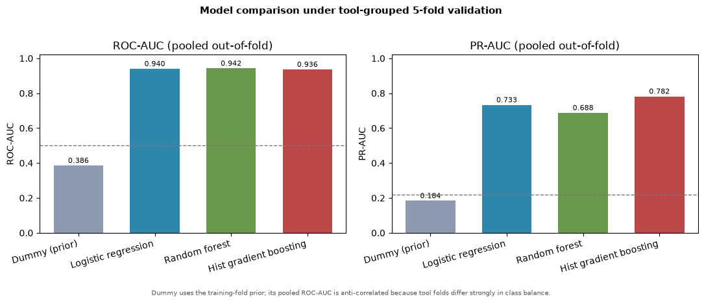

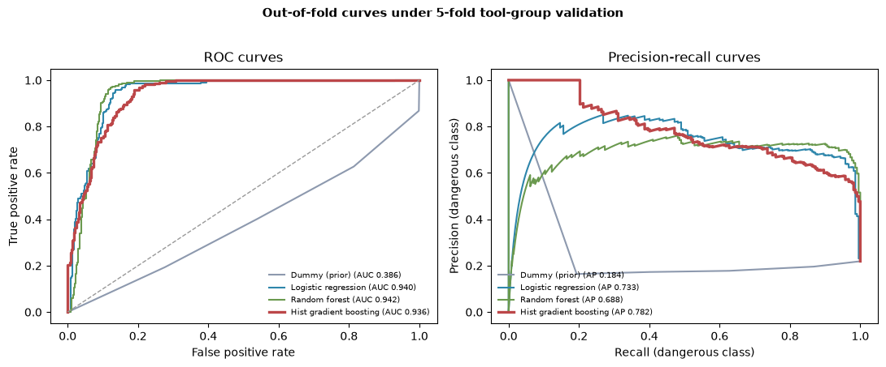

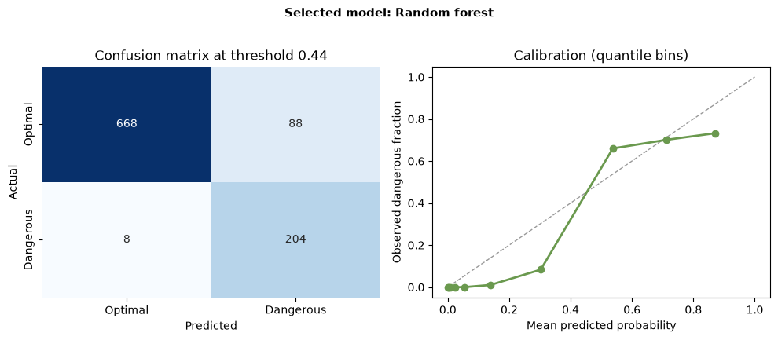

### 6.2 Where the errors are

| Tool | Actual class | Cycles | Mean P(dangerous) | Flagged | Error type |
|---:|---|---:|---:|---:|---|
| 2 | Dangerous | 48 | 0.732 | 100 % | — |
| 3 | Dangerous | 44 | 0.746 | 100 % | — |
| 4 | Dangerous | 41 | 0.712 | 92.7 % | 3 missed |
| 5 | Dangerous | 51 | 0.623 | 94.1 % | 3 missed |
| 6 | Dangerous | 28 | 0.676 | 92.9 % | 2 missed |
| 7 | Optimal | 124 | 0.563 | **60.5 %** | **75 false alarms** |
| 8 | Optimal | 116 | 0.149 | 5.2 % | 6 false alarms |
| 9 | Optimal | 149 | 0.026 | 0 % | — |
| 10 | Optimal | 15 | 0.052 | 0 % | — |
| 11 | Optimal | 1 | 0.022 | 0 % | — |
| 101 | Optimal | 84 | 0.029 | 0 % | — |
| 102 | Optimal | 82 | 0.006 | 0 % | — |
| 103 | Optimal | 60 | 0.014 | 0 % | — |
| 105 | Optimal | 125 | 0.104 | 5.6 % | 7 false alarms |

**False alarms (88).** 75 come from optimal tool 7, 7 from tool 105 and 6 from tool 8. Tool 7 has a
mean probability of 0.563, close to the dangerous tools, and its false alarms occur mostly late in
tool life. Its hardness and geometry apparently produce a signature that overlaps the dangerous
class. This is the single largest deployment risk: in a production cell it would trigger an
inspection on roughly three of every five tool-7 cycles.

**Missed dangerous cycles (8).** Three from tool 4, three from tool 5 and two from tool 6, spread
across tool life rather than confined to the first cycle. Their probabilities sit just below the
threshold, so a small threshold reduction would recover them at the cost of more false alarms. No
dangerous tool is systematically missed, which is better than losing an entire tool.

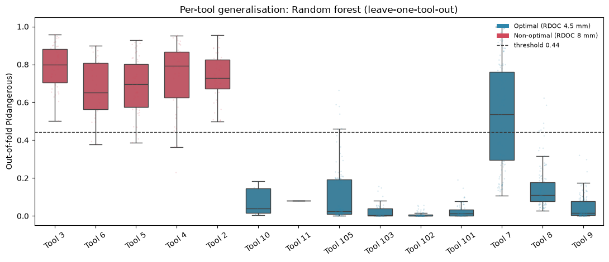

Figure 11 makes the same point visually: the dangerous tools sit as compact high-probability boxes,
while tool 7's optimal cycles overlap them.

The asymmetry matters: 8 missed dangerous cycles out of 212 is a 3.8 % miss rate, while 88 false
alarms out of 756 optimal cycles is an 11.6 % false-alarm rate. For a decision-support alarm that a
human filters, this is an acceptable starting point; for an automatic stop it would not be.

---

## 7. What the model has learned

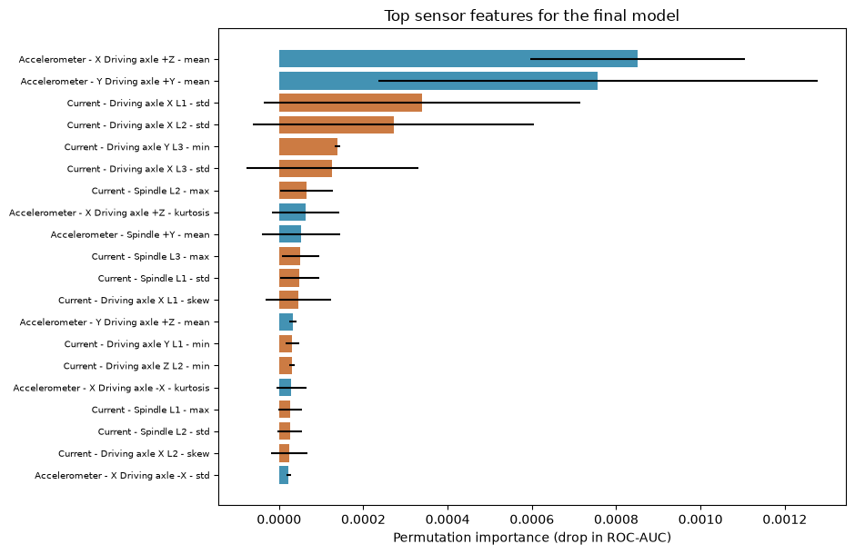

| Rank | Feature | Permutation importance (drop in ROC-AUC) |
|---:|---|---:|
| 1 | Accelerometer – X driving axle +Z – mean | 0.00085 ± 0.00026 |
| 2 | Accelerometer – Y driving axle +Y – mean | 0.00076 ± 0.00052 |
| 3 | Current – driving axle X L1 – std | 0.00034 ± 0.00038 |
| 4 | Current – driving axle X L2 – std | 0.00027 ± 0.00033 |
| 5 | Current – driving axle Y L3 – min | 0.00014 ± 0.00001 |
| 6 | Current – driving axle X L3 – std | 0.00013 ± 0.00020 |
| 7 | Current – spindle L2 – max | 0.00007 ± 0.00006 |
| 8 | Accelerometer – X driving axle +Z – kurtosis | 0.00006 ± 0.00008 |
| 9 | Accelerometer – spindle +Y – mean | 0.00005 ± 0.00009 |
| 10 | Current – spindle L3 – max | 0.00005 ± 0.00004 |

The absolute importances are small because the 120 features are highly correlated: shuffling one
channel leaves the others to compensate. The ranking is what matters. The model relies on drive-axis
mean acceleration and drive/spindle current variability, exactly the quantities that cutting mechanics
says should rise with radial engagement. It does not rely on an identifier, a wear counter or a
process setting, because those columns are not in the feature matrix.

The top feature is the **mean** of the drive-axis acceleration, not a peak or a kurtosis. That makes
sense for a static force offset: a deeper radial cut shifts the whole vibration signal upward, so its
DC level is a robust indicator. Current **standard deviation** ranks next because a heavier, more
interrupted cut produces a more variable load.

---

## 8. Demonstration on previously unseen cases

Two experiments were held out entirely: **P002** (RDOC = 8 mm, dangerous) and **P108** (RDOC = 4.5 mm,
optimal). A fresh random forest with the selected hyperparameters was trained on the remaining 22
experiments (841 cycles) and applied to the 127 held-out cycles.

| Experiment | Actual class | Cycles | Mean P(dangerous) | Min | Max | Flagged |
|---|---|---:|---:|---:|---:|---:|
| P002 | Dangerous | 46 | 0.746 | 0.439 | 0.953 | **97.8 %** (45/46) |
| P108 | Optimal | 81 | 0.006 | 0.000 | 0.046 | **0 %** (0/81) |

The single P002 miss is the **first cycle of the experiment** (`P002_F01_C1`, P = 0.439, just below
the 0.444 threshold). A fresh tool has not yet developed the wear-driven increase in vibration and
current, so its first cut looks marginal. This is a genuine engineering find, not a random failure:
it argues for a rolling window or a two-cycle confirmation logic rather than a per-cycle verdict at
the start of a tool's life.

The final saved model, which uses all 968 cycles, scores representative individual cycles through the
same 120-feature interface a deployment would use:

| Cycle | Experiment / tool | Actual | P(dangerous) | Decision |
|---|---|---|---:|---|
| `P002_F12_C4` | P002 / tool 2 | Dangerous | 0.967 | Flag |
| `P108_F12_C7` | P108 / tool 102 | Optimal | 0.000 | Clear |

This satisfies the CEP requirement to demonstrate the final model on at least two previously unseen
input cases, and it also tests a held-out experiment rather than a re-scored training row.

---

## 9. Engineering interpretation

The classifier behaves like a **data-driven cutting-force monitor**. When the radial engagement
increases from 4.5 mm to 8 mm, the chip load and the cutting force rise, the drive and spindle
currents increase and become more variable, and the drive-axis vibration shifts upward. The forest
combines several correlated channels into a decision boundary that separates the two conditions with
96 % recall at the selected operating point. The signal is therefore consistent with the mechanics
of the process, not merely with the labels.

The model's errors are also interpretable. Tool 7 is an optimal tool whose signature overlaps the
dangerous class, especially late in life; tools 4–6 occasionally produce a dangerous signature that
falls just below the threshold. Both patterns point to the same physical reality: wear, material
hardness and tool geometry move the sensor signature in the same direction as RDOC. A classifier
trained on a design where these factors are perfectly confounded cannot fully attribute the signal
to RDOC alone.

**Consequence of an error.** A false negative means a dangerous cut continues: higher force, faster
wear, possible chatter, scrap or tool breakage. A false positive means an unnecessary retract or
inspection, which costs cycle time but protects the machine. The threshold is therefore set to favour
recall, and the recommended use is a human-in-the-loop alarm, not an automatic stop.

---

## 10. Limitations and threats to validity

1. **Confounded experimental design (major).** RDOC and ADOC are constant within each tool and
   experiment. Tool geometry, material batch, hardness and wear stage are entangled with the target.
   Grouped validation and held-out experiments reduce optimism but cannot establish that the model
   responds to RDOC alone.
2. **Wear confound (major).** Dangerous tools fail sooner and sensor statistics drift with remaining
   life. Part of the separation may be wear rather than cutting condition. The dashboard's
   probability-versus-life view exposes this; a dedicated early-life-only analysis would be the next
   step.
3. **Small number of tools.** 14 tools, only 5 dangerous. Each leave-one-tool-out fold removes a
   substantial fraction of one class, and a single unusual tool (tool 7) drives most false alarms.
4. **Pre-computed features, no raw waveforms.** The 25 GB raw archive was not available, so the
   window length, filtering and statistic set could not be optimised. The 120 statistics are the
   authors' choices, not necessarily the best for this target.
5. **Uncalibrated sensor units.** Values are raw ADC counts. The model and threshold are specific to
   this machine and acquisition chain; transferring them requires calibration to g and A and
   re-validation.
6. **Single machine and campaign.** No independent machine, spindle or material set is available, so
   external validity is unknown.
7. **Threshold is a policy choice.** 0.444 is the max-F1 point. A plant with different inspection and
   scrap costs should choose a different operating point; the dashboard makes this explicit.
8. **No causal claim.** The model is a association-based alarm. It should not be described as proof
   that RDOC causes the observed signature in every tool.

---

## 11. Recommendations

1. **Deploy as decision support.** Require two consecutive flagged cycles or a short rolling mean
   before retracting a tool. This directly addresses the P002 first-cycle miss and reduces nuisance
   alarms from isolated cycles.
2. **Add a tool-specific baseline.** Compare each cycle with that tool's own early-life signature
   (a z-score or residual) rather than a global threshold. This is the most promising way to reduce
   the tool-7 false alarms.
3. **Re-run a balanced confirmation experiment.** Cut the same tool at both RDOC levels and vary
   hardness independently. That design would break the confounding and turn the current association
   into a defensible causal estimate.
4. **Calibrate the channels.** Convert accelerometer and current data to g and A, document the
   acquisition settings, and re-validate before using the model on a second machine.
5. **Tune the threshold to the shop-floor cost ratio.** Expose recall, false-alarm rate and the
   expected number of inspections per shift, and let maintenance/quality agree on the operating point.
6. **Log the probability and top features per cycle.** A process engineer needs to see *why* a cycle
   was flagged; the dashboard's per-cycle sensor view and the permutation ranking support that.
7. **Monitor drift.** Re-check the score distribution monthly; a change in material, holder or
   spindle shifts the sensor baseline and invalidates the threshold.

---

## 12. Deliverables and reproducibility

### 12.1 Deliverables

| CEP requirement | Delivered artifact |
|---|---|
| Raw dataset, unchanged | `data/raw/FeatureAndMetadata_Milling.csv`, `data/raw/metadata.xlsx` |
| Cleaned / transformed dataset | `data/processed/milling_clean.csv`, `features.csv`, `metadata.csv`, `folds.csv`, `sensor_long.csv` |
| Data audit and cleaning decisions | `data/processed/CLEANING_LOG.md`, `data/processed/audit.json`, `data/processed/data_dictionary.csv` |
| At least three visualisations | `figures/fig01`–`fig11` (11 figures) |
| Three to five engineering insights | `reports/EDA_INSIGHTS.md`, Section 4 of this report |
| At least three ML algorithms | Dummy, logistic regression, random forest, histogram gradient boosting |
| Leakage-safe training/testing | Nested 5-fold tool-group CV, leave-one-tool-out, leave-one-experiment-out, random-split control |
| Unseen-case demonstration | Held-out experiments P002 and P108 (Section 8) |
| Reproducible notebook | `notebooks/milling_cep_analysis.ipynb` (executed end to end, 0 errors) |
| Interactive dashboard | `dashboard/app.py` (Streamlit, six tabs, threshold slider, scoring, upload) |
| Live dashboard | <https://milling-cep-iguwxgwerngzavkpz2aguj.streamlit.app> |
| Tableau workbook support | `dashboard/tableau/*.csv` + `dashboard/tableau/README.md` build guide |
| Technical report | `reports/TECHNICAL_REPORT.md` / `.pdf` |
| Presentation | `reports/presentation/MILLING_CEP_SLIDES.pptx` / `.pdf` (13 slides) |
| Poster | `reports/poster/MILLING_CEP_POSTER.pdf` (A2) |
| Notebook export | `notebooks/exports/milling_cep_analysis.html` / `.pdf` |

The Streamlit app is the working interactive dashboard delivered with the project. The CEP brief
names Tableau Public (or an approved alternative) for the dashboard; the Tableau-ready extracts and
the step-by-step build guide allow the same views to be assembled in Tableau Public without
re-deriving any numbers. The `.twbx` workbook itself is a binary Tableau artifact and must be built
in Tableau Desktop/Public — it is not generated by the Python pipeline.

### 12.2 Reproduce

```bash
# Python 3.12; dependencies in requirements.txt (numpy, pandas, scikit-learn,
# matplotlib, seaborn, plotly, streamlit, joblib, jupyter)
.venv/bin/python -m src.data                 # cleaning, audit, folds, long sensor table
.venv/bin/python scripts/02_eda.py           # figures 01-06, EDA_INSIGHTS.md
.venv/bin/python scripts/03_modeling.py      # model comparison, figures 07-10
.venv/bin/python scripts/05_select_rf.py     # final model, threshold, unseen cases, figure 11
.venv/bin/python scripts/06_tableau_export.py
.venv/bin/jupyter nbconvert --to notebook --execute notebooks/milling_cep_analysis.ipynb
streamlit run dashboard/app.py
```

Random seed: `20261025`. The notebook reproduces the same threshold (0.4437), the same selected-model
metrics and the same unseen-case summary as the saved artifacts.

### 12.3 Environment

The project was developed with Python 3.12 in a local virtual environment. Hardware: ordinary laptop
CPU, no GPU. The full modelling pipeline (03 + 05) runs in a few minutes; the executed notebook in
about two minutes. The random forest is deliberately kept small (150 trees, depth ≤ 10) so the whole
study is reproducible on a student machine.

---

## 13. Conclusion

A random forest can separate optimal from non-optimal milling conditions from vibration and current
statistics with 96 % recall and an MCC of 0.76 under tool-grouped validation, and it generalises to
held-out experiments. The result is engineering-plausible: the model keys on drive-axis mean
acceleration and current variability, the quantities that cutting mechanics predicts will rise with
radial engagement. The main caveat is equally clear: because RDOC is confounded with tool identity,
material and wear, the model is a strong screening alarm rather than a causal instrument. With a
tool-specific baseline, two-cycle confirmation logic, calibrated sensors and a balanced confirmation
experiment, it could become a practical shop-floor safety monitor.

---

## References

1. Piecuch, M. & Żabiński, T. A new open dataset from a milling process – data for classification and estimation of tool life. *Scientific Data* **12**, 650 (2025). https://doi.org/10.1038/s41597-025-04923-y
2. Piecuch, M. & Żabiński, T. Dataset for the above article. Figshare (2025). https://doi.org/10.6084/m9.figshare.28589216 (CC BY 4.0).
3. Pedregosa, F. et al. Scikit-learn: Machine learning in Python. *Journal of Machine Learning Research* **12**, 2825–2830 (2011).
4. Breiman, L. Random forests. *Machine Learning* **45**, 5–32 (2001).
5. Saito, T. & Rehmsmeier, M. The precision-recall plot is more informative than the ROC plot when evaluating binary classifiers on imbalanced datasets. *PLOS ONE* **10**, e0118432 (2015).
6. Chicco, D. & Jurman, G. The advantages of the Matthews correlation coefficient (MCC) over F1 score and accuracy in binary classification evaluation. *BMC Genomics* **21**, 6 (2020).
7. NED University of Engineering and Technology, Department of Mechanical Engineering. *ME-446 AI & IoT, Complex Engineering Problem — Fall 2026* (course brief).
